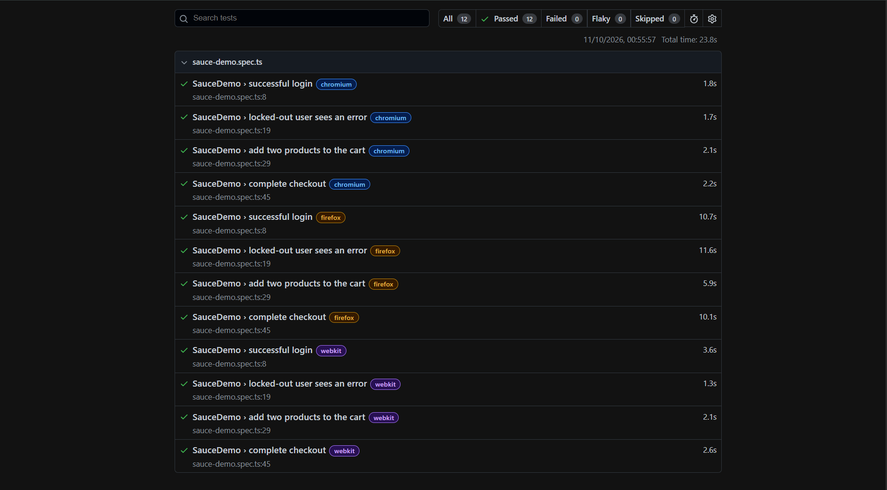

# Playwright MCP Demo


End-to-end tests for [SauceDemo](https://www.saucedemo.com) built with Playwright and TypeScript. I used Playwright MCP with GitHub Copilot to explore the app and draft the tests, then reviewed and refactored them by hand.

## What's covered
- Successful login
- Locked-out user sees an error
- Add two products to the cart
- Complete checkout

Tests run on Chromium, Firefox and WebKit (12 test runs) and execute automatically in GitHub Actions on every push.

## Tech stack
Playwright · TypeScript · Page Object Model · Playwright MCP · GitHub Copilot · GitHub Actions

## Test report


## How I used Playwright MCP
1. Asked the agent to open SauceDemo and describe the login form and checkout flow.
2. Had it draft tests based on what it explored.
3. Reviewed the output and made it reliable by hand. Write 1 or 2 real changes you made here, for example: "moved selectors into page objects" or "replaced weak assertions with specific checks".

## Run it locally
```bash
npm install
npx playwright install
npx playwright test
npx playwright show-report
```

## MCP setup
`.vscode/mcp.json` configures the Playwright MCP server for VS Code.

## What I'd improve next
Add one or two real ideas here, for example: API tests, data-driven tests, or visual comparisons.